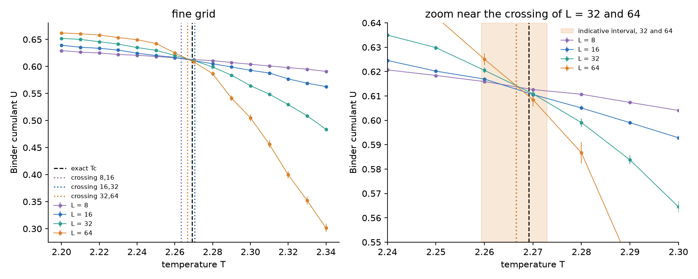
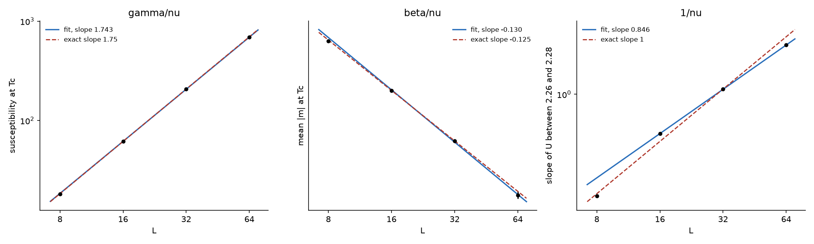

# Two-dimensional Ising model: Metropolis, Wolff and the critical point

I simulate the 2D Ising model with the Metropolis algorithm on lattices up to 64 x 64 and compare the critical temperature and critical exponents with the exact values, with error bars from blocks, jackknife and bootstrap. I also compare how fast the Wolff cluster algorithm decorrelates relative to Metropolis at the critical point.

## Headline result

- Tc from the Binder crossing of L = 32 and L = 64: **2.2666**, bootstrap standard error 0.0035, indicative interval [2.2594, 2.2729].
- Exact Tc: 2.2692.
- Difference (estimate minus exact): -0.0026, which is -0.76 standard errors.

The interval covers the exact value.





All three pairs of sizes:

| Pair of sizes | Crossing | Standard error | Interval low | Interval high |
|---|---|---|---|---|
| 8 and 16 | 2.2634 | 0.0020 | 2.2585 | 2.2668 |
| 16 and 32 | 2.2705 | 0.0024 | 2.2651 | 2.2739 |
| 32 and 64 | 2.2666 | 0.0035 | 2.2594 | 2.2729 |

## Critical exponent ratios

Least-squares fits of the logarithm of the observable against the logarithm of L, with bootstrap errors. The primary fit uses sizes 16, 32, 64.

| Quantity | Sizes | Estimate | Standard error | Indicative interval | Exact | Difference (standard errors) |
|---|---|---|---|---|---|---|
| gamma/nu | 16, 32, 64 | 1.743 | 0.006 | [1.730, 1.755] | 1.750 | -1.11 |
| gamma/nu | 8, 16, 32, 64 | 1.747 | 0.004 | [1.740, 1.755] | 1.750 | -0.69 |
| beta/nu | 16, 32, 64 | 0.130 | 0.004 | [0.121, 0.138] | 0.125 | +1.04 |
| beta/nu | 8, 16, 32, 64 | 0.127 | 0.003 | [0.122, 0.132] | 0.125 | +0.76 |
| 1/nu | 16, 32, 64 | 0.846 | 0.118 | [0.606, 1.071] | 1.000 | -1.30 |
| 1/nu | 8, 16, 32, 64 | 0.950 | 0.071 | [0.801, 1.087] | 1.000 | -0.70 |

## Dynamic exponents

- Metropolis z = 1.96 +/- 0.07
- Wolff z = 0.20 +/- 0.02

The commonly quoted Metropolis value is about 2.17, and four small lattices give only a rough estimate. The error is the least-squares standard error of a four-point line. For Wolff the time is converted to sweep equivalents by multiplying with the mean cluster size over N. At L = 64 the Metropolis autocorrelation time is 184.4 sweeps and the Wolff time is 1.51 sweep equivalents, a ratio of 121.9. This compares decorrelation per sweep equivalent, not computing time.

Runs flagged blocks_short: 0. Metropolis runs in total: 104. A flagged run would have block length below 10 autocorrelation times, and its error bars would probably be too small. The flag uses the autocorrelation time of |m| and not the one of the energy. For the energy, the lowest block length over autocorrelation time is 152.5 (L = 64, T = 2.29) against the limit of 10, all 104 energy autocorrelation times converged, and the energy time is shorter than the |m| time in every run.

## Method in short

- Square lattice, periodic boundaries, `J = 1`, all spins up at the start of every run.
- Metropolis with a checkerboard update (two colours, `numpy.roll` for neighbours), 50000 sweeps discarded, 500000 measured, one measurement per sweep.
- Wolff cluster update at Tc only, 5000 updates discarded, 100000 measured.
- Temperature grid of 25 values from 2.00 to 2.60 (finer, 0.01 steps, from 2.20 to 2.34), plus one run at exactly Tc for each L in 8, 16, 32, 64.
- Estimators from 50 block means per run, jackknife errors by deleting one block at a time.
- Integrated autocorrelation time with an automatic window (6 times tau).
- Binder crossing from the last sign change on the fine grid, with linear interpolation.
- Block bootstrap (2000 replicates) for everything that combines runs.
- Every run has its own random generator seeded from the master seed, the algorithm, L and the run index.

## Pre-registration

`PREREGISTRATION.md` was written before any simulation was run. It fixes the model, algorithms, constants, estimators and the primary result. These choices were fixed before any simulation was run and were not changed afterward.

## Tests

`tests/test_ising.py` uses fixed seeds. It checks the energy against a brute-force loop, the checkerboard update, an exact enumeration of all 65536 states of the 4 x 4 lattice against Metropolis (three temperatures) and Wolff, detailed-balance limits, reproducibility, the autocorrelation estimator on an AR(1) series, the jackknife, the exact formulas, the Binder limits, the crossing rule and the scaling fit. The full test run takes about two minutes.

```bash
pytest
```

## Limitations

- The lattices are small (8 to 64), so corrections to scaling are present. The L = 8 data shows them, for example in the (8, 16) crossing.
- Single-spin Metropolis is slow near Tc. Runs flagged blocks_short have error bars that are probably too small. None was flagged here, but the flag does not guarantee exact errors.
- Temperatures are a fixed grid with no histogram reweighting, so the crossing is a linear interpolation.
- There is one seed per run.
- Pure numpy speed limits L to 64.
- The dynamic exponent fits use four points.

## File layout

- `README.md`: this file.
- `PREREGISTRATION.md`: choices fixed before any simulation.
- `LICENSE`: MIT licence.
- `config.py`: all constants.
- `ising.py`: samplers, estimators, jackknife, bootstrap, autocorrelation, exact formulas.
- `run_metropolis.py`: all Metropolis runs, restartable.
- `run_wolff.py`: Wolff runs at Tc.
- `analyze.py`: writes the CSV files in `results/`.
- `check_consistency.py`: checks that README numbers match `results/`.
- `1_Ising_Analysis.ipynb`: executed analysis notebook.
- `requirements.txt`: pinned package versions.
- `tests/test_ising.py`: unit tests.
- `results/runs/`: one JSON file per run (estimators, errors, block means, autocorrelation times).
- `results/observables.csv`: every estimator with its error for every run.
- `results/crossings.csv`: Binder crossings with bootstrap errors.
- `results/exponents.csv`: exponent ratios.
- `results/dynamics.csv`: autocorrelation times and z.
- `results/exact_comparison.csv`: L = 64 energy and magnetization against the exact infinite-lattice values.
- `results/exact_check_4x4.csv`: pulls from the 4 x 4 exact enumeration.
- `results/summary.csv`: headline numbers.
- `data/`: raw E and M series at Tc (compressed npz files).
- `Images/`: figures written by the notebook.

## How to run from a fresh clone

```bash
python3 -m venv .venv
source .venv/bin/activate
pip install -r requirements.txt
```

```bash
pytest
```

```bash
python run_metropolis.py
```

```bash
python run_wolff.py
```

```bash
python analyze.py
```

```bash
jupyter nbconvert --to notebook --execute --inplace 1_Ising_Analysis.ipynb
```

```bash
python check_consistency.py
```

Tested with Python 3.12.5 on macOS.

On my laptop with 4 worker processes the Metropolis runs took about half an hour, the Wolff runs under two minutes and the analysis about a minute and a quarter.

## References

- Onsager (1944), "Crystal Statistics. I. A Two-Dimensional Model with an Order-Disorder Transition".
- Yang (1952), "The Spontaneous Magnetization of a Two-Dimensional Ising Model".
- Metropolis, Rosenbluth, Rosenbluth, Teller and Teller (1953), "Equation of State Calculations by Fast Computing Machines".
- Binder (1981), "Finite Size Scaling Analysis of Ising Model Block Distribution Functions".
- Wolff (1989), "Collective Monte Carlo Updating for Spin Systems".

## What's next

Histogram reweighting, larger lattices with a compiled sampler, and the 3D model where no exact solution exists.

## Data source

All data in this repository is generated by the simulation code in this repository. Nothing is downloaded.
